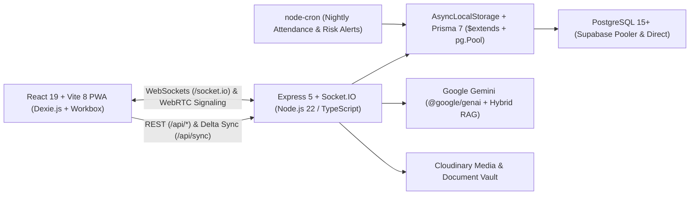

<div align="center">

# EdBase

**Multi-Tenant, Offline-First Academic Operations & Student Workspace Platform**

[](https://github.com/dotDRN/edbase/releases)
[](./LICENSE)
[](https://www.typescriptlang.org/)
[](https://react.dev/)
[](https://expressjs.com/)
[](https://www.prisma.io/)
[](https://supabase.com/)

*Built for distributed schools, learning centers, and NGOs — combining strict multi-tenant isolation, offline-first IndexedDB sync, real-time WebRTC/Socket.IO collaboration, and a grounded Google Gemini AI orchestrator.*

</div>

---

## Engineering Highlights

- **Row-Safe SaaS Multi-Tenancy:** Isolates workspaces (`Organization`) automatically across requests using `AsyncLocalStorage` and Prisma `$extends` query extensions, with self-service instance onboarding (`/api/auth/register-instance`) and 9-role RBAC + center-scoping.
- **Offline-First PWA & Conflict-Resolving Sync:** Partitions **Dexie.js** IndexedDB stores per `(tenantId, userId)`, caches reads, queues mutations in a causal outbox with temporary ID remapping, resolves concurrent edits via field-level 3-way merge (`SyncEngine`), and degrades gracefully on `503 DB_UNAVAILABLE`.
- **Universal AI Orchestrator (`Google Gemini`):** Staff Copilot drawer (`AiCopilotDrawer`), hybrid semantic + lexical RAG search, episodic conversation threads, long-term institutional entity memory, 360° student briefings, 30-60-90 day career playbooks, and vertical PII redaction (`piiGuard.ts`).
- **Real-Time Collaboration & WebRTC Huddles:** Tenant-isolated **Socket.IO** chat (direct, group, and entity threads, Cloudinary attachments, reactions, read receipts), persistent notifications, and peer-to-peer **WebRTC** staff meeting rooms (voice, video, screen share, host moderation).
- **Production-Hardened Deployment:** Single-service **Render + Supabase** ready ([`render.yaml`](./render.yaml)), PgBouncer transaction-pooler + `DIRECT_URL` migration separation, proxy-aware rate limiting, Helmet CSP, and graceful `SIGTERM`/`SIGINT` shutdown.

---

## System Architecture



---

## Core Feature Matrix

| Domain | Capabilities |
| :--- | :--- |
| **Multi-Tenancy & RBAC** | Self-service workspace registration, 9 user roles (`super_admin`, `tech_admin`, `center_admin`, `supervisor`, `teacher`, `staff`, `volunteer`, `parent`, `shareholder`), date-bounded center grants, active kill-switch |
| **Student Lifecycle & Dossier** | Enrollment, bulk import, academic year cohort promotion, inter-center transfers, fee payment ledger, guardian linking, 360° longitudinal dossier timeline, Cloudinary document vault |
| **Field Ops & Offline Sync** | Printable QR student ID cards, camera QR check-in scanner, Dexie.js partitioned local DB, causal outbox queue, idempotent `/api/sync/push`, Workbox PWA |
| **Academics & Holistic Tracking** | Fresh daily attendance sheets, holiday flags, monthly registers & absence streaks, dynamic-subject exams (baseline/midline/endline), class skill matrices, activity enrollments & credits, batch cohorts |
| **AI Intelligence & Risk Alerts** | Gemini AI Copilot, hybrid RAG, 360° student briefings, 30-60-90 day career guidance playbooks, configurable dropout/attendance/exam/fee alert rules evaluated nightly per tenant |
| **Collaboration & Portals** | Real-time Socket.IO chat, in-app & browser notifications, WebRTC staff meeting rooms, read-only Parent/Guardian portal (`/parent`) |
| **Forms & Analytics** | JSON-schema dynamic form builder, KoboToolbox template/submission sync, filtered analytics, formula-sanitized CSV exports, 6-sheet Excel master workbooks (`xlsx`) |

---

## Tech Stack

- **Frontend:** React 19, TypeScript, Vite 8 (Rolldown code splitting), Tailwind CSS v4, Zustand v5, TanStack React Query v5, Dexie.js v4, Workbox (`vite-plugin-pwa`), Socket.IO Client, Recharts, SheetJS (`xlsx`), QRCode
- **Backend:** Node.js 22+, Express 5, TypeScript, Prisma 7 (`@prisma/adapter-pg` + `pg`), PostgreSQL 15+ (Supabase), Zod v4, Socket.IO, Google Gemini (`@google/genai`), Cloudinary, Multer, `node-cron`, Helmet, `express-rate-limit`
- **Testing & Quality:** Node native test runner + `tsx` (`95` backend unit tests across `24` suites; `7` frontend unit tests across `2` suites), strict TypeScript, ESLint (`0` errors, `0` warnings)

---

## Quick Start (Local Development)

### Prerequisites
- **Node.js** 22+ and **npm**
- **PostgreSQL** 15+ (local Postgres, Docker, or **Supabase**)

### Setup
1. **Clone and install dependencies:**
   ```bash
   git clone https://github.com/dotDRN/edbase.git
   cd edbase
   npm run install:all
   ```
2. **Configure environment variables:**
   Copy `backend/.env.example` to `backend/.env` (and optionally `frontend/.env.example` to `frontend/.env`). Configure `DATABASE_URL`, `DIRECT_URL`, `JWT_ACCESS_SECRET`, and `JWT_REFRESH_SECRET` in `backend/.env` (plus `CLOUDINARY_*` and `GEMINI_API_KEY` if using uploads/AI).
3. **Run Prisma migrations:**
   ```bash
   npm run db:deploy
   ```
   *(For schema edits in local development, run `npx prisma migrate dev` inside `backend/`.)*
4. **Seed demo data (optional — development databases only):**
   > **Warning:** `prisma db seed` wipes all existing rows before inserting sample records. Never run it on a production database.
   ```bash
   npx --prefix backend prisma db seed
   ```
   Demo credentials (workspace slug `default`):
   - **Super Admin:** `super_admin@edbase.org` / `SuperAdmin@123`
   - **Tech Admin:** `tech_admin@edbase.org` / `SuperAdmin@123`
   - **Center Admin / Teacher / Staff:** `center_admin_1@edbase.org`, `teacher_1@edbase.org`, `staff_1@edbase.org` / `Staff@123`
5. **Start both dev servers:**
   ```bash
   npm run dev
   ```
   - Frontend: `http://localhost:5173` (proxies `/api`, `/health`, and `/socket.io` to port `5000`)
   - Backend: `http://localhost:5000`

---

## Scripts & Verification

| Command | Purpose |
| :--- | :--- |
| `npm run dev` | Run backend (`tsx watch`) and frontend (`vite`) concurrently |
| `npm test` | Run all backend (`95` tests) and frontend (`7` tests) unit suites |
| `npm run lint` | Run ESLint across `frontend/` |
| `npm run build` | Install dependencies and build both backend and frontend for production |
| `npm run build:backend` | Generate Prisma Client and compile TypeScript (`backend/dist`) |
| `npm run build:frontend` | Type-check (`tsc -b`) and bundle frontend + PWA (`frontend/dist`) |
| `npm run db:deploy` | Generate Prisma Client and run `prisma migrate deploy` |
| `npm start` | Start production Express server (`node backend/dist/server.js`, serving `frontend/dist`) |

---

## Production Deployment (Render + Supabase)

EdBase deploys as a single **Render Web Service** (Express API + Socket.IO + static `frontend/dist` SPA) backed by **Supabase PostgreSQL** via [`render.yaml`](./render.yaml):

1. Provision a **Supabase** project and grab both the **Transaction Pooler** URI (`DATABASE_URL`, port `6543` with `?pgbouncer=true&sslmode=require`) and the **Session/Direct** URI (`DIRECT_URL`, port `5432` for Prisma migrations).
2. Deploy via Render Blueprint (`render.yaml`) or manually configure a Node Web Service:
   - **Build Command:** `npm run build`
   - **Start Command:** `npm run db:deploy && npm start`
   - **Health Check Path:** `/health`
3. Set `DATABASE_URL`, `DIRECT_URL`, `CLIENT_URL`, `JWT_ACCESS_SECRET`, `JWT_REFRESH_SECRET`, and optional `CLOUDINARY_*` / `GEMINI_API_KEY` secrets.

Docker Compose (`docker-compose.yml`) and multi-stage `Dockerfile` are also included. See **[Deployment Guide](./documentation/02-DEPLOYMENT.md)** for complete instructions.

---

## Documentation

Start at **[Documentation Index](./documentation/INDEX.md)**:

1. [System Architecture](./documentation/01-ARCHITECTURE.md)
2. [Deployment (Render, Supabase & Docker)](./documentation/02-DEPLOYMENT.md)
3. [Database Architecture](./documentation/03-DATABASE.md)
4. [API Reference](./documentation/04-API_REFERENCE.md)
5. [Security, Multi-Tenancy & RBAC](./documentation/05-SECURITY_AND_RBAC.md)
6. [Frontend Guide](./documentation/06-FRONTEND.md)
7. [Maintenance Playbook](./documentation/07-MAINTENANCE.md)

---

## Repository Layout

```text
├── backend/              # Express 5 API, Socket.IO, Gemini AI, Prisma 7 schema & unit tests
├── frontend/             # React 19 + Vite 8 SPA, Dexie offline DB, Workbox PWA & unit tests
├── documentation/        # Architecture, deployment, database, API, RBAC & maintenance guides
├── scripts/              # Host helper scripts
├── Dockerfile            # Multi-stage production container image (Node 22 + Prisma 7)
├── docker-compose.yml    # Containerized app + PostgreSQL 15 stack
├── render.yaml           # Render Blueprint infrastructure spec
├── LICENSE               # MIT License
└── package.json          # Root monorepo scripts & metadata
```

## License

Licensed under the [MIT License](./LICENSE).
